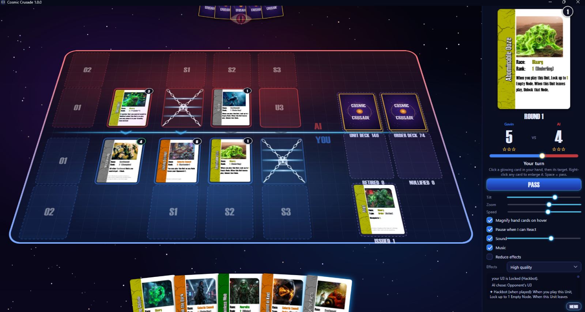

# Cosmic Crusade

**A card game of galactic war.** Deploy your Units, issue Orders, outrank your opponent. Play the AI, or a friend online.

<!-- TODO image: hero.png is a placeholder. Replace with a screenshot of a game mid-round: the 3D table, a fanned hand and the side panel (about 1600×900). See docs/images/README.md. -->

Cosmic Crusade is a free Windows game for two players. Six races fight across a battlefield of nodes:
- Space Cowboys
- Necrolites
- Overmind
- Blaarg
- Synthenoids
- the Galactic Council

Each round, both sides deploy Units and play Orders until they pass. The higher total Rank wins the round, and the first to win 3 rounds wins the game.

## Features

- **Play the AI:** Easy, Normal or Hard. Normal and Hard simulate their options before every turn.
- **Play a friend online:** host, share a 5-letter code, play. Includes chat, and the game reconnects by itself if someone drops.
- **Play on your home network:** the included LAN Server needs no accounts or internet.
- **Every card works:** 237 cards, all of them playable.
- **Optional modules:**
  - **Warzones:** a new battlefield each round;
  - **Archons:** once-per-game power cards;
  - **Spacecraft:** ships your Units can crew.
- **Your own rules:** No Leaders, True Singleton or Random Draw modes, and a card pool you can tune card by card.
- **A living table:** a 3D board, card-specific animations, generated sound and music.

## Download and install

1. Get **`CosmicCrusade-Setup-<version>.exe`** from whoever shares the game with you.
2. Run it. It installs for your user only, with no admin rights and nothing else to install.
3. Windows SmartScreen may warn that the setup is unrecognised, because it isn't code-signed. Choose **More info → Run anyway**.

You need Windows 10 or 11 (64-bit). Uninstalling (Settings → Apps) keeps your name and server settings.

## Quick start

1. Start **Cosmic Crusade**, type your name on the right, and click **PLAY VS AI**.
2. Click a glowing card in your hand, then a glowing node. Press **Space** to pass.
3. When you've both passed, the higher total wins the round.

Then read **[How to play](docs/players/HOW-TO-PLAY.md)**.

## Documentation

| Page | What's in it |
|---|---|
| [How to play](docs/players/HOW-TO-PLAY.md) | Your first game: the menu, the table, taking turns, reacting, tips |
| [Rulebook](docs/players/RULEBOOK.md) | The full rules, including Warzones, Archons and Spacecraft |
| [Glossary](docs/players/GLOSSARY.md) | Every term on the cards and in the app |
| [Playing online](docs/players/PLAYING-ONLINE.md) | Hosting, joining, chat, drops |
| [LAN guide](docs/players/LAN-GUIDE.md) | Playing on your home network |
| [Host your own server](docs/players/HOST-YOUR-OWN-SERVER.md) | Your own free online relay on Cloudflare |
| [Developing](docs/developing.md) | Building from source, the solution layout, multiplayer testing, releasing the installer |

## Licence

The software is [MIT](LICENSE) © 2026 Gavin Nicholls. The **game itself** (its concepts, rules, theme, races, card names and text) is © 2026 Gavin Nicholls, **all rights reserved**: see [LICENSE](LICENSE). Card art was generated with Google Gemini. The engine and app were developed with Claude (Anthropic). Third-party components are listed in [THIRD-PARTY-NOTICES.md](THIRD-PARTY-NOTICES.md).
